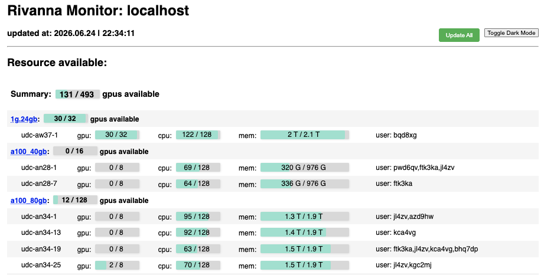

# Slurm Website Monitor for UVA Rivanna
A website-based resource monitor for [SLURM](https://slurm.schedmd.com/documentation.html) systems, tailored specifically for the UVA Rivanna computing environment.

This project extends the original implementation developed for the [Visual Geometry Group](https://www.robots.ox.ac.uk/~vgg/), Oxford, with enhancements and customizations to better serve the specific needs of our research group at the University of Virginia.

## Features
- Parses the results from the `sinfo` command every 1 seconds to update CPU/GPU resource usage.
- Hosts statistics on an internally accessible webpage, providing a convenient overview of system status.

## Screenshot


## News
- [06/24/2026]: Add slurm template; Fix the bug that planned/reserved GPUs were not showing as being in use; The allocations now are obtained based on user personal information; Add dynamic GPU partitions.
- [08/12/2025]: Add Multi-Instance GPU partition
- [04/29/2025]: Add disk quota, H200 partition, and manual update button.
- [10/31/2024]: Add allocations.
- [10/31/2024]: Launched customized version for UVA Rivanna.

## Installation
To install necessary dependencies, run:
```
pip install -r requirements.txt
```

## Usage
To launch the web monitor:
```
python app.py --host localhost --port 8080
```
Access the website at `localhost:8080`. Adjust the host and port as needed for your setup.

Modify the [index.html](index.html) to customize the header, footer, and formatting to suit your group's preferences.

## Command-Line Tool
For command-line usage:
```
python slurm_web/slurm_gpustat.py
```

Alternatively, add this alias to your `.bash_profile`:
```
alias slurm_gpustat='python ~/slurm_web/slurm_gpustat.py'
```

To view the statistics of only the available resources, run:
```
python available_resources.py 
```

## `rres`: command line for people and agents
[bin/rres](bin/rres) wraps `sinfo` / `squeue` / `scontrol` / `sbatch --test-only` and
reports the same numbers as the web page. Every subcommand accepts `--json`, which agents
should use. Nothing is ever submitted or cancelled.
```
export PATH="$HOME/rivanna_resource/bin:$PATH"   # or call bin/rres directly

rres gpus                    # per GPU type: free / total GPUs, GPU memory, queue length
rres nodes --free            # per node: free GPUs, CPUs, memory, status, users
rres eta --gpus 2 --time 6:00:00   # estimated start of such a job on every GPU type
rres template a100_80gb --gpus 2 --time 12:00:00 -o job.sh   # SBATCH script, then: sbatch job.sh
rres eta --script job.sh     # estimated start of an existing script
rres jobs                    # your jobs, with pending reasons and start estimates
rres accounts                # SU balance of your allocations
rres quota                   # storage quotas
```
Free GPUs do not imply an immediate start: nodes marked `planned` hold their idle
resources for a pending higher-priority job, and many nodes have idle GPUs but no memory
left (see the `FULL_SHARE` column). `rres eta` gives the scheduler's own estimate.
`rres <command> --help` lists all options. The wrapper uses `$RRES_PYTHON` if set,
otherwise the `rivanna_resource` conda env, otherwise `python3`.

`rres` works on any Slurm cluster: it needs only `python3` (3.6+, no packages) and the
Slurm client commands. Site-specific pieces degrade gracefully: without UVA's
`allocations`, `rres accounts` lists your Slurm accounts without balances; without
`hdquota`, `rres quota` says so; without `sacctmgr`, templates omit `--account`.
GPU memory per type comes from the type name (`a100_80gb`, `1g.24gb`) or a built-in
table; override or extend it with e.g. `RRES_GPU_MEMORY="a100=80,v100=16"`.

## Credits
This project is based on the original `slurm_gpustat` tool developed by [Samuel Albanie](https://github.com/albanie/slurm_gpustat) and `slurm_web
` developed by [Tengda Han](https://tengdahan.github.io/). It has been modified and maintained for the UVA Rivanna system by the UVA CV Lab, with the aim of providing enhanced monitoring tools for Rivanna.

## Reference
Further documentation and updates can be found at the original [slurm_gpustat repository](https://github.com/albanie/slurm_gpustat).
